# DE1-SoC Audio Player

Програвач музики для плати **Terasic DE1-SoC** (ядро ARM Cortex-A9) і симулятора
**[CPUlator](https://cpulator.01xz.net/?sys=arm-de1soc)**, а також застосунок, що з
будь-якого треку (mp3, wav, flac, ogg) робить готовий до завантаження файл,
сам його перевіряє й відкриває CPUlator із уже завантаженим треком.

Розширення лабораторної роботи №5 «Обробка аудіосигналу» з курсу «Проектування
систем на кристалі» (КПІ ім. Ігоря Сікорського).

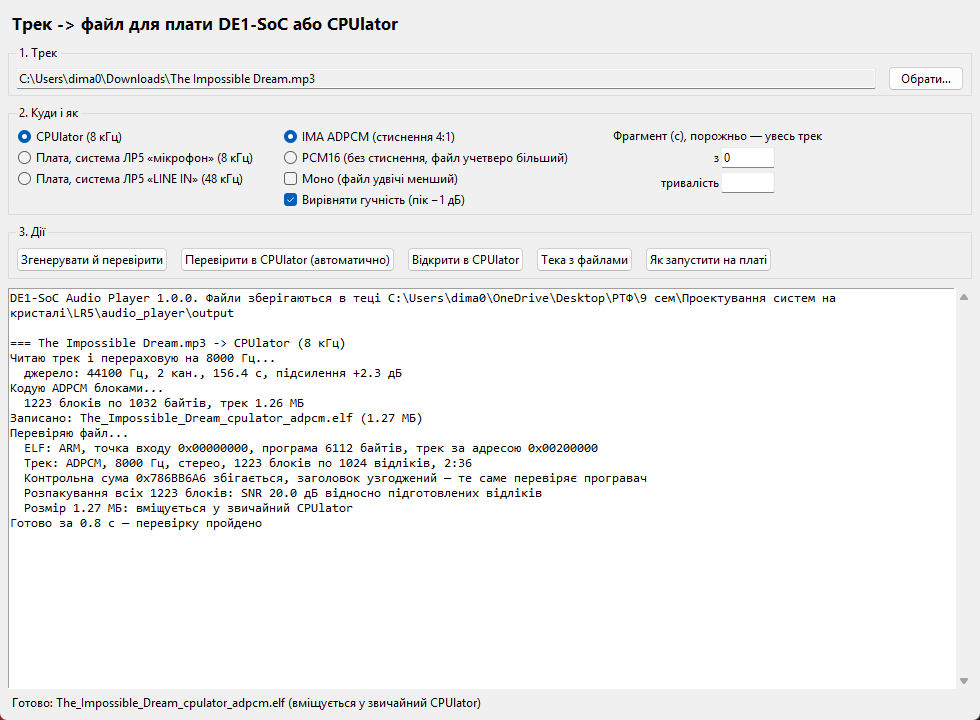

## Що вміє

- **Відтворення на платі й у CPUlator** однією й тією самою програмою: частоту,
  затримку черги звуку й наявність HEX задає заголовок треку.
- **Кнопки:** KEY0 — пауза й продовження (позицію оцінено за таймером, тож
  можлива мала похибка), KEY1 — з початку, KEY2 / KEY3 — на 10 с назад / уперед.
  Коли трек дограє, світлодіоди гаснуть, а KEY0 запускає його знову.
- **Шкала рівня гучності** на LEDR9…LEDR0: пік за кожні 20 мс у децибелах,
  спад 1 світлодіод за 40 мс, утримання піку 0,6 с. На паузі шкала блимає.
- **Час на HEX3…HEX0** у CPUlator (у системі ЛР5 на платі індикаторів немає).
- **Самоперевірка:** перед стартом програвач перевіряє узгодженість полів
  заголовка й контрольну суму даних. Якщо трек не проходить перевірку, він блимає
  світлодіодами через один. Сума адитивна, тому виявляє обрив передачі й зіпсовані
  ділянки, але не будь-яке пошкодження.
- **Застосунок** перераховує трек на 8 або 48 кГц, стискає IMA ADPCM (4:1) або
  лишає PCM16 без стиснення, складає ELF без компілятора на вашому комп'ютері й
  перевіряє результат: заголовок, контрольна сума, розпакування всіх блоків, SNR,
  розмір.
- **Автоматична перевірка в CPUlator** у браузері без вікна: шкала рухається,
  черга звуку не спорожнюється, KEY0 і KEY1 працюють, трек доходить до кінця.
- **CPUlator для великих файлів.** Звичайний CPUlator на файлах понад ~2,3 МБ
  замовкає (вада розширення пам'яті WebAssembly). Застосунок відкриває його
  через місцевий посередник, який виділяє пам'ять одразу, — і трек грає.

| Відтворення в CPUlator | Пауза | Кінець треку |
|---|---|---|
| 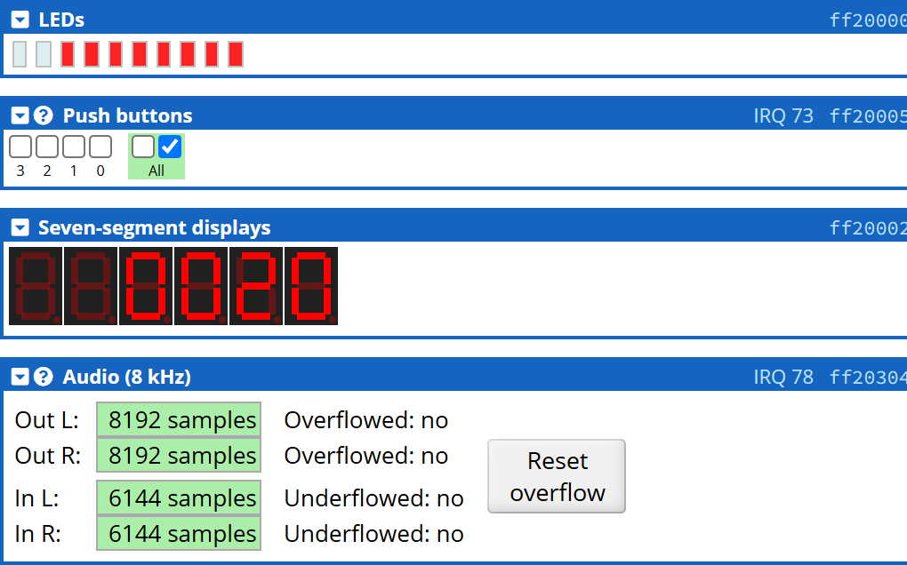 | 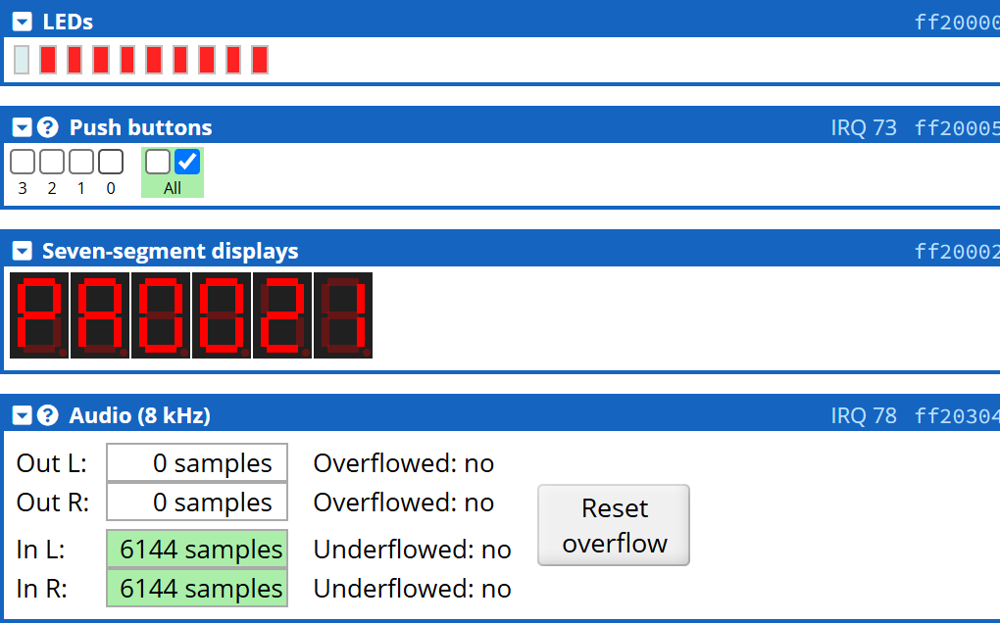 | 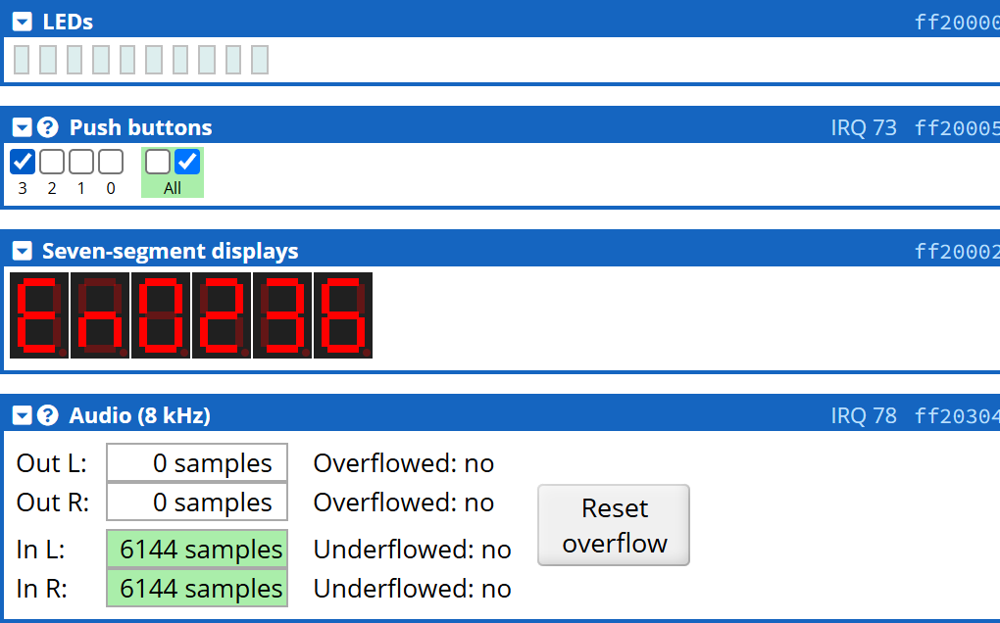 |

## Швидкий старт

1. Завантажте репозиторій (**Code → Download ZIP** або `git clone`) і розпакуйте.
2. Двічі клацніть **`run.bat`**. Перший запуск сам створить середовище Python і
   поставить бібліотеки (близько хвилини, потрібен інтернет). Далі вікно
   відкривається одразу.
   Потрібен Python 3.10+ ([python.org](https://www.python.org/downloads/));
   для перевірки в CPUlator — Chrome або Edge.
3. **Обрати…** → трек, у пункті «Куди і як» — ціль і кодек.
4. **Згенерувати й перевірити.** Файл з'явиться в теці `output`.
5. **Відкрити в CPUlator** → трек завантажиться сам → натисніть **Continue
   мишею** (без клацання браузер не вмикає звук).

| Ціль | Частота | Для чого |
|---|---|---|
| CPUlator | 8 кГц | симулятор у браузері |
| Плата, система ЛР5 «мікрофон» | 8 кГц | основний проєкт ЛР5 |
| Плата, система ЛР5 «LINE IN» | 48 кГц | варіант ЛР5 із входом LINE IN |

## Запуск на платі DE1-SoC

1. Прошийте ПЛІС системою ЛР5 з тією самою частотою, що й трек: 8 кГц — основний
   проєкт, 48 кГц — варіант LINE IN.
2. **Intel FPGA Monitor Program → File → New Project:** архітектура ARM
   Cortex-A9, `<Custom System>` з `Computer_System.sopcinfo` і `.sof` тієї ж
   системи, Preloader DE1-SoC; тип програми **AXF, ELF or SREC File**, файл —
   згенерований `.elf` (або `.srec`, якщо ELF не прийметься).
3. **Actions → Download System**, потім **Actions → Load** (великий трек іде
   через JTAG до хвилини) і **Continue**.
4. Навушники або колонки — у зелене гніздо **LINE OUT**.

Те саме є в застосунку на кнопці «Як запустити на платі».

## Як це влаштовано

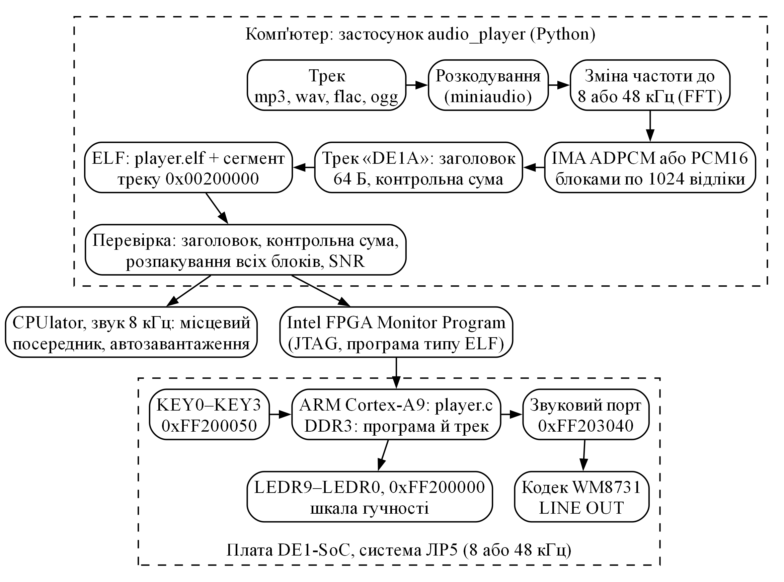

**Файл для завантаження** — звичайний ELF для ARM: перший сегмент — програвач
(`firmware/build/player.elf`, близько 6,1 КБ коду) з адреси `0x00000000`, другий —
трек з адреси `0x00200000`. Ці адреси є в DDR3 і на платі, і в CPUlator.

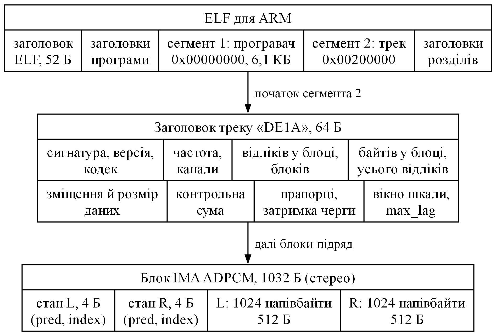

Трек поділено на **незалежні блоки по 1024 відліки**: на початку кожного блоку
лежить стан декодера IMA ADPCM. Тому програвач може почати з будь-якого
блоку (пауза, перезапуск, перемотування), а кодер на комп'ютері обробляє всі
блоки одночасно масивами numpy — 2,5 хвилини стерео кодуються за секунду.

| Стани програвача | Основний цикл |
|---|---|
| 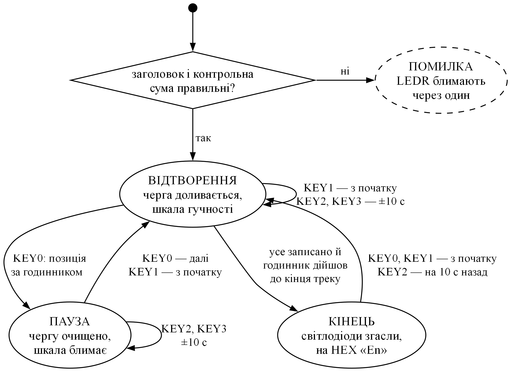 | 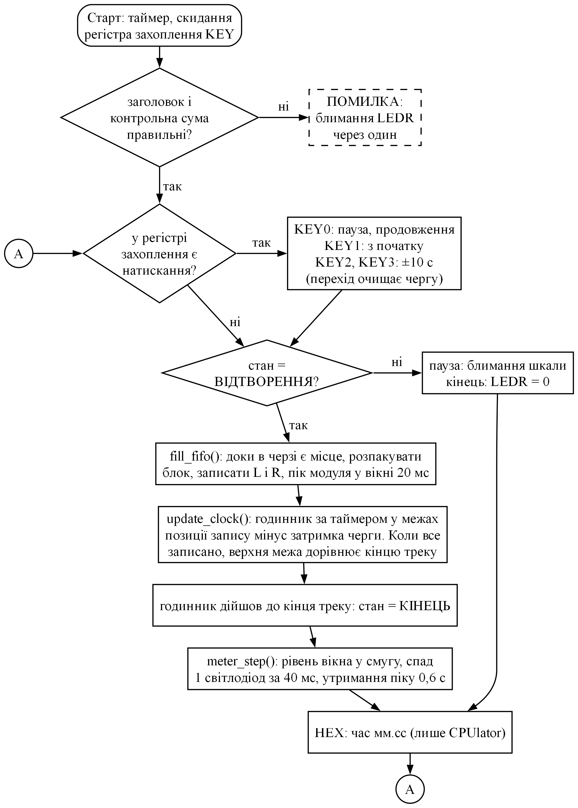 |

**Шкала гучності.** Під час запису в чергу звуку програвач рахує пік модуля за
кожні 20 мс. Рівень світлодіодів — пороги −39, −33, −28, −24, −20, −16, −12, −9,
−6, −3 дБ від повної шкали.

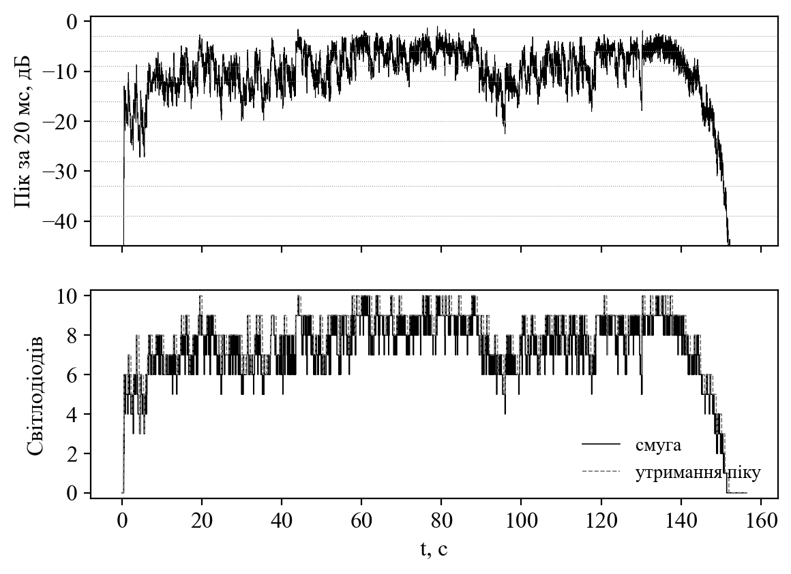

**Годинник шкали.** Щоб шкала збігалася з тим, що чути, програвач тримає
оцінку «що зараз звучить»: вона йде за приватним таймером ядра, але не виходить
за межі `pos − затримка черги` (`pos` — скільки відліків записано). На платі черга
кодека тримає 128 відліків і годинник просто йде за записом. У CPUlator черга
тримає 8192 відліки й спорожнюється блоками по 2048 щочетверть секунди —
таймер згладжує ці стрибки, і шкала рухається рівно. Коли всі відліки вже в
черзі, верхньою межею стає кінець треку: годинник доходить до нього за таймером,
поки останні відліки ще звучать, і програвач переходить у стан КІНЕЦЬ.

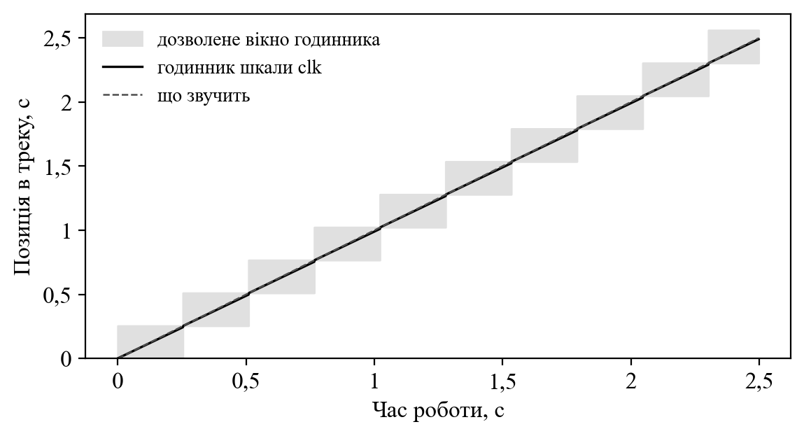

**Якість стиснення.** IMA ADPCM дає 4 розряди на відлік. На 48 кГц — SNR близько
34 дБ, на 8 кГц — близько 20 дБ відносно підготовлених відліків, тобто вже після
зміни частоти дискретизації й вирівнювання гучності. Режим PCM16 не додає втрат
кодування, але перерахунок частоти лишається.

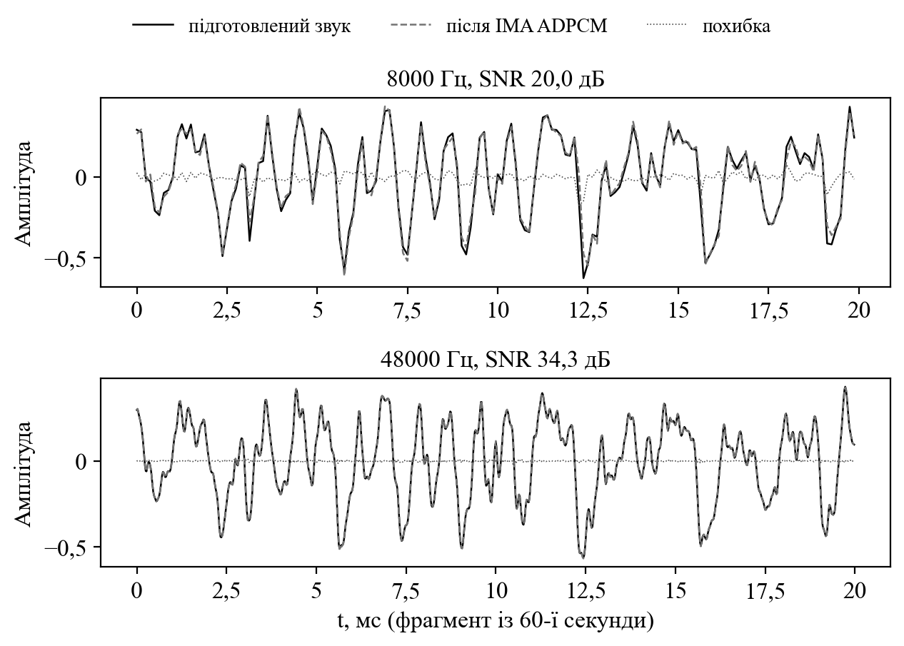

## Результати перевірки

Трек 2:36, стерео, 44,1 кГц:

| Ціль | Кодек | Розмір файла | SNR | Перевірка в CPUlator |
|---|---|---|---|---|
| CPUlator, 8 кГц | ADPCM | 1,27 МБ | 20,0 дБ | 9 з 9 у звичайному CPUlator |
| CPUlator, 8 кГц | PCM16 | 5,02 МБ | без втрат кодування | 9 з 9 з наперед виділеною пам'яттю; у звичайному — шкала й звук стоять |
| Плата, 8 кГц | ADPCM | 1,27 МБ | 20,0 дБ | логіка — 9 з 9 |
| Плата, 48 кГц | ADPCM | 7,57 МБ | 34,3 дБ | логіка — 9 з 9 (у CPUlator звучить ушестеро повільніше) |
| Плата, 48 кГц | PCM16 | 30,0 МБ | без втрат кодування | — |

ELF, складений застосунком, читають `arm-altera-eabi-readelf` і `arm-altera-eabi-gdb`
(через нього вантажить Monitor Program): розділи `.text`, `.bss`, `.blob` на своїх
адресах, за `0x00200000` — сигнатура треку `DE1A`.

## Командний рядок

```bat
python app\cli.py make трек.mp3 --target cpulator|board8|board48 [--codec adpcm|pcm16] [--mono]
python app\cli.py check output\файл.elf [--cpulator [--bigmem]]
python app\cli.py cpulator output\файл.elf [--bigmem]
```

## Структура

```
app/                  застосунок (Python)
  main.py             вікно
  cli.py              командний рядок
  deplayer/           audio, codec (IMA ADPCM), blob (формат), elf, verify,
                      helper (посередник CPUlator), check (перевірка без вікна)
firmware/             програвач для ARM Cortex-A9
  player.c, crt0.s, player.ld
  build/player.elf    зібраний шаблон (компілятор користувачу не потрібен)
  build.bat           перезбирання (Intel FPGA Monitor Program 18.1)
tests/                test_header.py (python -m unittest discover tests) і
                      cpulator_broken_tracks.py (зіпсовані файли в CPUlator)
docs/                 рисунки й make_figures.py, що їх будує
run.bat               запуск одним клацанням
```

## Обмеження

- На реальній платі програвач поки не запускався — плати не було. Логіку
  (кнопки, шкалу, розпакування) перевірено в CPUlator на тих самих файлах, що
  призначені для плати.
- У CPUlator звук іде з затримкою близько секунди (черга симулятора), шкала
  враховує її оцінкою; браузер може додати ще 0,1–0,3 с.
- Музика в репозиторій не входить — треки обираєте свої.

---

Гандзюк Дмитро, група РС-61мн, КПІ ім. Ігоря Сікорського, 2026
